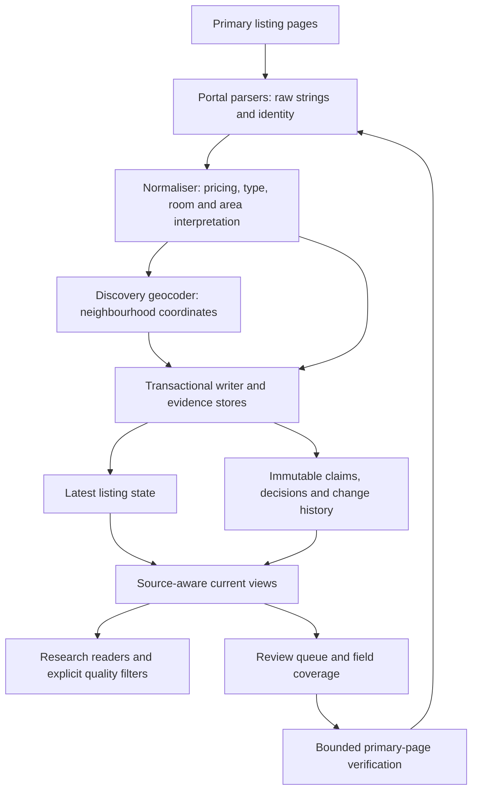

# How the pieces fit together

Start with [CODEBASE.md](CODEBASE.md) for the conversational walkthrough and
[docs/database.md](docs/database.md) for the database dictionary. This page is the
short map, checked against the project on 19 November 2026.

For the confirmed shared-data boundary and the proposed local working/archive
database, read [the storage layout guide](docs/storage-layout.md). It distinguishes
the current deployment from the planned split and explains publication/recovery.

We collect adverts from three enabled portals: PropertyPro, Private Property and
Nigeria Property Centre. Jiji has a parser but is disabled in normal orchestration.
The output is a set of portal listings and their evidence, not a certified register
of unique physical properties or completed transactions.

Discovery finds and revisits adverts in portal feeds. Health checks visit selected
saved URLs and can refresh full observations. Controlled repair tools assess saved
evidence without portal requests. Primary-page verification retrieves missing
support or fresh values. Those are different operations, so their manifests,
checkpoints and side effects should remain explicit.

## The layers

| Layer | Main files | Responsibility |
| --- | --- | --- |
| Extraction | `scraper/parsers/`, `models.py` | Read the primary listing, keep raw fields and metric provenance |
| Interpretation | `normaliser.py`, `pricing.py`, `property_types.py`, `property_counts.py`, `room_counts.py`, `area_measurements.py`, `property_facts.py` | Produce typed claims with basis, status, evidence and unresolved questions |
| Reviewed cases | `property_reviews.py`, `property_reviews.json` | Apply identity- and exact-source-bound human decisions |
| Persistence | `db_writer.py`, the classification/count/room/area stores | Commit saved state and its audit together |
| Current readers | Numbered SQL migrations | Expose applicable interpretations and retained values without erasing history |
| Operations | `orchestrator.py`, `health_checker.py`, repair/recovery modules and scripts | Bound work, coordinate traffic, resume interrupted runs and report outcomes |
| Presentation | Telemetry scripts, `templates/`, generated `web/` | Static operational dashboard; not the research contract |

## The contracts that matter

The taxonomy identifies form and facets. Counts distinguish assets offered, units
contained, per-dwelling layouts and availability. Features remain claims about
amenities. Prices retain purpose, currency, cadence and basis. Rooms retain the
stored number separately from its evidence and supporting candidate. Areas keep
land, floor and unspecified sizes separate, including units, scope and conflicts. Do not roll
those dimensions into a long property-type label or a single generic quantity.

The room-aware reader is `raw_data.property_research_current`, contract
`property-research-v2`. Migration 014 adds the easier `research.properties`,
`research.review_queue` and `research.room_count_coverage` entry points. Until
014 is installed, use the existing raw_data readers. The aliases do not duplicate
stored listings or solve cross-portal identity. Migration 015 appends supported
and retained area fields to `research.properties` and adds `research.area_measurements`
for inspecting individual area claims. It reuses the existing fact history.

A current interpretation is one that applies to the saved source. That is different
from a recently fetched page and from a physically verified property fact. A
current room assessment can truthfully retain an unverified bathroom count. Read
field statuses and review flags; do not use one listing-wide boolean as a universal
quality certificate.

## Operational boundaries

PostgreSQL is the durable data store. Discovery/health checkpoints are local JSON;
controlled repairs also have database manifests and receipts. The rental recovery
runner has a separate local SQLite ledger. Private frozen reports and backups live
under ignored `.local/`; they are not application tables.

Normal local and cloud wrappers currently replay numbered migrations. The older
view introductions must therefore preserve fields introduced later. A checksummed
migration ledger is a future improvement that needs every entry point to change
together. Installing a migration is not equivalent to backfilling or verifying data.

The same-host traffic guard gives health checks priority over recovery and prevents
multiple recovery runners from competing. It is not a distributed lock across a
laptop and GitHub Actions. Coordinate those schedules deliberately; respect robot
directives, request budgets and portal limits when collecting new evidence.

The detailed guide covers known limitations and next improvements: retained source
evidence, field coverage, migration tracking, physical-property matching, area
roles, storage/query profiling and honest dashboard fallbacks. Keep those concerns
visible without silently changing the meaning of an existing consumer field.
